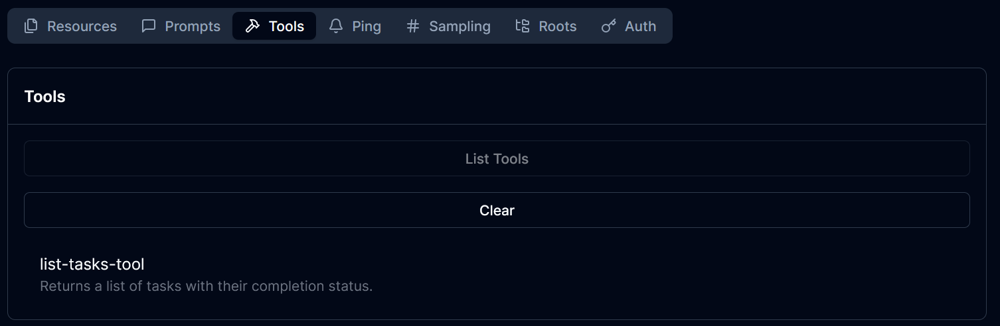

# Laravel + PHP 8.4 + MySQL

La aplicación Laravel vive en `php/src` y se sirve mediante Apache.

- Aplicación: http://localhost:8000
- phpMyAdmin: http://localhost:8080
- MySQL desde el host: `localhost:9906`

## Arranque

```bash
docker compose build
docker compose up -d
```

Dentro de Docker, Laravel usa `db` como host de MySQL, con base de datos y usuario `laravel`, y contraseña `laravel`.

Para ejecutar migraciones manualmente (desde tu local):

```bash
docker compose exec php-apache-environment php artisan migrate
```

Pasos cuando Laravel está en blanco (este repo ya lo tiene hecho):
1. Instalar el MCP de Laravel

```bash
docker compose exec php-apache-environment composer require laravel/mcp
```

2. Traerse del vendor las rutas de IA para poderlas modificar:

Desde fuera del container

```bash
docker compose exec php-apache-environment php artisan vendor:publish --tag=ai-routes
```
3. Ahora creamos el servidor MCP. En nuestro caso será un manejador de tareas TaskServer

```bash
docker compose exec php-apache-environment php artisan make:mcp-server TaskServer
```

Esto creará una archivo nuevo en app/Mcp/Servers/

Modifica el router IA para que referencíe a este nuevo servidor
```php
<?php

use App\Mcp\Servers\TaskServer;
use Laravel\Mcp\Facades\Mcp;

Mcp::web('/mcp/task', TaskServer::class);
```

4. Verifica que Laravel conoce el endpoint

```bash
docker compose exec php-apache-environment php artisan route:list --path=mcp
```

Debes obetner como respuesta las rutas encontradas
```bash
  GET|HEAD   mcp/task ...................................................................................................................... vendor/laravel/mcp/src/Server/Registrar.php:45
  DELETE     mcp/task ...................................................................................................................... vendor/laravel/mcp/src/Server/Registrar.php:47
  POST       mcp/task ...................................................................................................................... vendor/laravel/mcp/src/Server/Registrar.php:49
                         
```

5. Ahora generaremos nuestra primera tool con make:mcp-tool

```bash
docker compose exec php-apache-environment php artisan make:mcp-tool ListTasksTool
```
Esto generará el archivo app/Mcp/Tools/ListTasksTool.php

Modifica la descripción en el nuevo archivo
```php
#[Description('Returns a list of tasks with their completion status.')]
```

Agrega algunas tareas que regresar para probar el método
```php
    public function handle(Request $request): Response
    {
        $tasks = [
            [
                'id' => 1,
                'title' => 'Learn Laravel MCP',
                'completed' => false,
            ],
            [
                'id' => 2,
                'title' => 'Prepare for technical interview',
                'completed' => false,
            ],
        ];

        return Response::text(
            json_encode($tasks, JSON_PRETTY_PRINT | JSON_THROW_ON_ERROR)
        );
    }
```

6. Registrar la herramienta en el servidor

En TaskServer.php hay un arreglo tools actualmente vacío.
```php
    protected array $tools = [
        //
    ];
```

Modifiquémoslo con nuestra tool nueva
```php
    protected array $tools = [
        \App\Mcp\Tools\ListTasksTool::class,
    ];
```

En OTRA TERMINAL lanza MFC inspecto, que es como un Postman para MCP
```bash
npx @modelcontextprotocol/inspector
```xmlx

Debe terminar con un mensaje de que está corriendo en un puerto:
```bash
🔑 Session token: dfb9ddfc... <-- copiar

🔍 MCP Inspector is up and running at http://127.0.0.1:6274 🚀 <-- dar click
```

Abre la URL y colca tres datos en el panel de la izquierda:
- Transport Type: Streamable HTTP
- URL: http://localhost:8000/mcp/task
- Expandir configuración y en "Proxy session token" pegar el que te haya generado

En la barra de arriba, da click en tools y luego "List Tools". Debería aparecer la herramienta de listar tareas
```
list-tasks-tool
Returns a list of tasks with their completion status.
```



7. Vamos a empezar con el proceso de que las Tasks salgan de la BD. Para ello comenzaremos creando un modelo:

```bash
docker compose exec php-apache-environment php artisan make:model Task -m
```

Eso creará el modelo y la migración:
```bash

   INFO  Model [app/Models/Task.php] created successfully.  

   INFO  Migration [database/migrations/2026_10_19_211556_create_tasks_table.php] created successfully. 
```

8. Modificamos la migración recientemente creada para soportar los datos necesarios

```php
public function up(): void
{
    Schema::create('tasks', function (Blueprint $table) {
        $table->id();
        $table->string('title');
        $table->text('description')->nullable();
        $table->boolean('completed')->default(false);
        $table->timestamps();
    });
}
```

Luego migramos
```bash
docker compose exec php-apache-environment php artisan migrate
```

Debemos obtener algo como esto:
```bash
   INFO  Running migrations.  

  2026_10_19_211556_create_tasks_table ............................................................................................... 195.92ms DONE
```

9. Modificar el modelo Task para describir correctamente los campos de la tabla que creamos

```php

namespace App\Models;

use Illuminate\Database\Eloquent\Model;

class Task extends Model
{
    protected $fillable = [
        'title',
        'description',
        'completed',
    ];

    protected function casts(): array
    {
        return [
            'completed' => 'boolean',
        ];
    }
}
```

10. Insertar datos de prueba desde Thinker

Ejecutar Thinker
```bash
docker compose exec php-apache-environment php artisan tinker
```

Deberá mostrar algo como esto:
```bash
Psy Shell v0.12.24 (PHP 8.4.26 — cli) by Justin Hileman
New PHP manual is available (latest: 3.1.4). Update with `doc --update-manual`
> 
```

Ejecuta código para insertar una task (en PHP):
```php
$task = App\Models\Task::create([
    'title' => 'Learn Laravel MCP',
    'description' => 'Build an MCP server with Laravel and MySQL',
    'completed' => false,
]);
```

La respuesta será la instancia creada con ID:
```bash

= App\Models\Task {#8002
    title: "Learn Laravel MCP",
    description: "Build an MCP server with Laravel and MySQL",
    completed: false,
    updated_at: "2026-10-19 21:32:48",
    created_at: "2026-10-19 21:32:48",
    id: 1,
  }
```

11. FInalmwente, modificamos ListTasksTool para que el contenido provenga de BD

```php
public function handle(Request $request): Response
{
    $tasks = Task::all();

    return Response::text(
        $tasks->toJson(JSON_PRETTY_PRINT | JSON_THROW_ON_ERROR)
    );
}
```